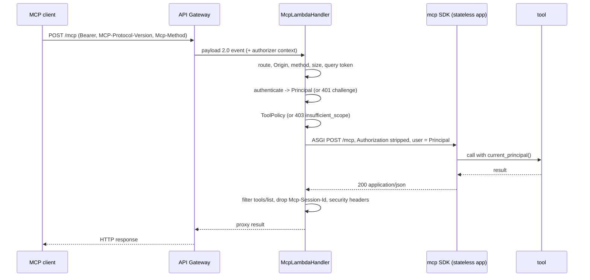

# Architecture

```text
serverless_mcp_aws/
  handler.py         McpLambdaHandler / lambda_handler_for: routing, origin, method, limits,
                     auth, batching, tool policy, response headers
  bridge.py          SdkBridge: one stateless JSON-mode streamable_http_app per invocation,
                     ASGI scope from the event, principal into the SDK, headers stripped
  events.py          API Gateway HTTP API payload 2.0 -> HttpRequest; HttpResponse -> proxy result
  jsonrpc.py         error envelopes and message classification
  origin.py          OriginPolicy (exact allowlist, localhost:* ports)
  authorizer.py      authorizer_handler_for: HTTP API REQUEST authorizer, simple responses
  dev.py             DevServer: HTTP -> event -> handler, optional authorizer emulation
  cli.py             `serverless-mcp-aws dev module:attr`
  cdk.py             McpServerFunction, LambdaAuthorizer, JwtAuthorizer (the `cdk` extra)
  auth/
    jwt.py           JWTVerifier, JWKSCache, fetch_url
    authenticators.py BearerAuth, AuthorizerContextAuth, AuthError
    principal.py     Principal, current_principal(), principal_scope()
    policy.py        ToolPolicy (scope -> tools, default deny)
    metadata.py      ProtectedResourceMetadata (RFC 9728), WWW-Authenticate challenges
```

## One invocation



## Decisions

- **The SDK owns the protocol.** Header validation for the 2026-07-28 envelope,
  `server/discover`, protocol negotiation and tool dispatch are the official
  SDK's. This package owns what is specific to Lambda and to a public endpoint:
  events, statelessness, origin, auth, policy, metadata.
- **A fresh app per invocation.** The SDK's session manager runs once per
  instance and keeps a task group; Lambda runs one request per container at a
  time and freezes between them. Building the stateless app per invocation is
  cheap (milliseconds) and leaves nothing behind. Put expensive setup (clients,
  configuration) at module scope.
- **JSON responses, not SSE.** API Gateway HTTP APIs buffer Lambda responses,
  so a stream would arrive all at once anyway. `subscriptions/listen` cannot be
  served and is refused.
- **Batches are unpacked here.** The SDK accepts one message per POST, which is
  what every revision since 2025-06-18 requires. For `2025-03-26` clients the
  handler splits the array and runs each message through the same policy and SDK.
- **Policy before the SDK.** A refused tool never reaches tool code; the
  `tools/list` filter is applied to the SDK's response.
- **Two auth placements, one verifier.** The same `JWTVerifier` runs in the
  function (`BearerAuth`) or in a Lambda authorizer; `AuthorizerContextAuth`
  reads its context (or API Gateway's JWT authorizer claims).
- **The construct is least privilege by construction.** No managed policies:
  the role starts with log writes to one log group, and the caller grants the rest.
