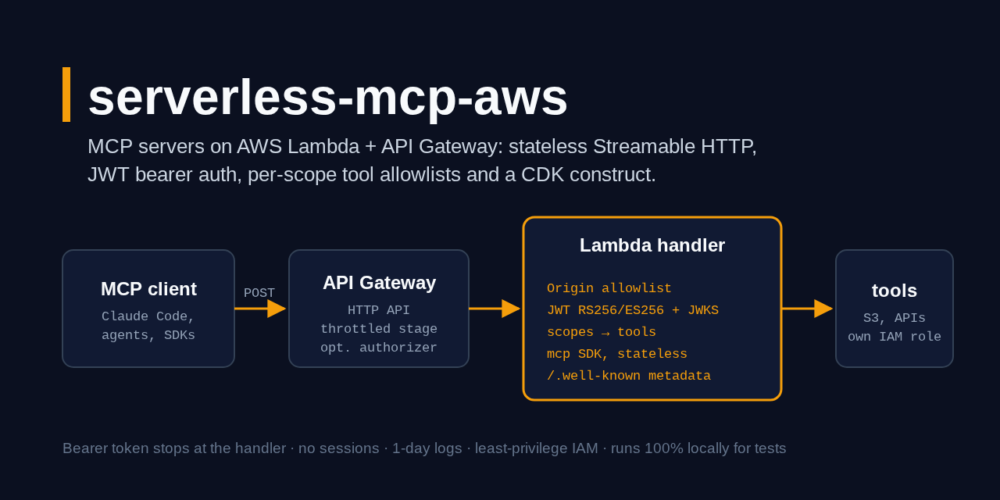
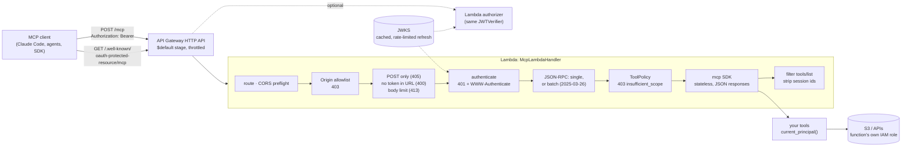

# serverless-mcp-aws

> Run an MCP server on AWS Lambda behind API Gateway (HTTP API): stateless Streamable HTTP through the official `mcp` SDK, JWT bearer auth (RS256/ES256 + JWKS), per-scope tool allowlists, OAuth protected resource metadata and an AWS CDK construct.

[](https://github.com/MartinCastroAlvarez/serverless-mcp-aws/actions/workflows/ci.yml)
[](LICENSE)
[](pyproject.toml)
[](pyproject.toml)
[](https://modelcontextprotocol.io)



`serverless-mcp-aws` turns an `MCPServer` from the official Python SDK into a
Lambda handler: `handler = lambda_handler_for(server, auth=...)`. Each API
Gateway HTTP API event becomes one stateless MCP exchange (the 2026-07-28
per-request envelope, or the 2025 `initialize` handshake for older clients),
the bearer token is verified and stopped at the handler, the caller's scopes
decide which tools it can list and call, and the response goes back as a Lambda
proxy result. A CDK construct builds the Lambda, the HTTP API, an optional
authorizer and least-privilege IAM, and a dev server runs the very same handler
on localhost. Runs 100% locally, no paid APIs required: tests use locally
generated keys, moto and the official MCP client, and the CDK code is only ever
synthesised.

## Why

MCP's Streamable HTTP transport was designed for long-lived processes. Lambda
is the opposite: no memory between requests, a buffered 30-second response, and
an API Gateway in front that already does TLS, throttling and authorizers. The
2026-07-28 revision made MCP stateless, but getting it right on Lambda is still
a pile of details:

- **One request, one invocation.** No `Mcp-Session-Id`, no GET stream, no
  in-memory state. The SDK runs in stateless JSON-response mode per invocation;
  `subscriptions/listen` (a long-lived stream) is refused with 404, `GET`/`DELETE`
  with 405, as the spec says for stateless servers.
- **Auth the way the MCP authorization spec wants it.** RFC 9728 metadata at
  both well-known paths, `401` with `WWW-Authenticate: Bearer resource_metadata=...`,
  `403 insufficient_scope` naming the scopes that would grant the tool, audience
  bound to the server's canonical URI (RFC 8707), tokens never accepted in the URL.
- **JWT verification that does not fall for the classics.** `alg=none`,
  HS256-signed-with-the-public-key, `kid` confusion, embedded `jwk`/`jku`,
  oversized tokens, unknown-`kid` refresh storms: all refused and all tested.
- **No token passthrough.** Tools see a `Principal` (subject, scopes), never the
  bearer token; `Authorization` and cookies are stripped before the SDK.
- **Infrastructure you can read.** One construct, 1-day logs, a throttled stage,
  an IAM role that can only write its own logs until you grant more.

## Quickstart

```bash
pip install "serverless-mcp-aws[cdk] @ git+https://github.com/MartinCastroAlvarez/serverless-mcp-aws"
git clone https://github.com/MartinCastroAlvarez/serverless-mcp-aws && cd serverless-mcp-aws
python -m examples.local_demo                       # fake IdP + moto S3 + dev server + MCP client
serverless-mcp-aws dev examples.notes.app:server    # :8000/mcp, no auth; set NOTES_BUCKET (examples/README.md)
claude mcp add --transport http notes http://127.0.0.1:8000/mcp
```

It will be `pip install "serverless-mcp-aws[cdk]"` once the first release is on PyPI.

```python
# app.py, deployed as the Lambda handler "app.handler"
from mcp.server.mcpserver import MCPServer
from serverless_mcp_aws import (
    BearerAuth, JWTVerifier, ProtectedResourceMetadata, ToolPolicy,
    current_principal, lambda_handler_for,
)

server = MCPServer("notes")

@server.tool()
def whoami() -> str:
    """Who is calling."""
    return current_principal().subject

handler = lambda_handler_for(
    server,
    auth=BearerAuth(JWTVerifier.from_env()),                  # MCP_JWT_ISSUER, MCP_JWT_JWKS_URL, ...
    resource_metadata=ProtectedResourceMetadata.from_env(),   # MCP_RESOURCE, MCP_AUTHORIZATION_SERVERS
    tool_policy=ToolPolicy({"notes:read": ["whoami"]}),
    allowed_origins=["https://app.example.com"],              # browsers; non-browser clients send no Origin
)
```

```python
# stack.py (synth only in this repo; deploying is your call)
from serverless_mcp_aws.cdk import McpServerFunction
mcp = McpServerFunction(self, "Notes", code=lambda_.Code.from_asset("build"), handler="app.handler",
                        environment={...})
bucket.grant_read_write(mcp.function, "notes/*")
```

## How it works



1. **Routing.** The MCP path (default `/mcp`) and the two RFC 9728 paths
   (`/.well-known/oauth-protected-resource/mcp` and the root variant) are served;
   everything else is 404. Metadata is public and CORS-open (`*`, no credentials).
2. **Origin.** A browser always sends `Origin` on a cross-site POST; it must be
   in `allowed_origins` (exact `scheme://host[:port]`, or `http://localhost:*`)
   or the request gets 403 before auth runs. Requests without `Origin`
   (SDKs, agents, curl) pass. This is the spec's DNS-rebinding defence.
3. **Authentication.** `BearerAuth(JWTVerifier(...))` checks the token in the
   function; `AuthorizerContextAuth()` trusts what an API Gateway authorizer put
   in `requestContext.authorizer` (a client cannot write that), re-checking `exp`.
   Failures are 401 with `resource_metadata`, `scope` and a fixed `error_description`.
4. **Messages.** A single JSON-RPC message goes to the SDK. A JSON array is a
   batch: allowed only for protocol `2025-03-26` (or no version header, which the
   spec says means 2025-03-26), at most 20 items, no `initialize`; each item is
   dispatched and the replies come back as an array (202 if all were notifications).
5. **Authorization.** For `tools/call`, the tool must be granted by one of the
   token's scopes (`ToolPolicy`, default deny, `"*"` for an admin scope);
   otherwise 403 `insufficient_scope` with the scopes that would grant it.
   `tools/list` results are filtered to the same set and marked `cacheScope: private`.
6. **The SDK.** A fresh stateless `streamable_http_app` (JSON responses) handles the
   message: protocol-version negotiation, `Mcp-Method`/`Mcp-Name` header
   validation (`HeaderMismatch` -32020), `server/discover`, tool dispatch. The
   principal is visible to tools via `current_principal()` and the SDK's
   `get_access_token()` (with an empty `token` field).
7. **Response.** `Mcp-Session-Id` is never minted or echoed; `Cache-Control: no-store`,
   `X-Content-Type-Options: nosniff`, CORS headers for allowed origins.

### The JWT verifier

| Check | Rule |
| --- | --- |
| Algorithms | allowlist subset of `{RS256, ES256}`; `none`, `HS*`, everything else refused at construction and per token |
| Key selection | only from the configured JWKS URL (https; http only for loopback); `kid` must match a key of the right type (RSA for RS256, P-256 for ES256); no `kid` only with a single-key JWKS |
| Keys skipped | `oct`, `use != sig`, mismatched `alg`, RSA < 2048 bits, non-P-256 curves, keys carrying private parts |
| Header | `jku`, `jwk`, `x5u`, `x5c`, `crit` refused; `typ` must be `JWT`/`at+jwt` (`require_typ=True` demands `at+jwt`) |
| Claims | `exp`, `iss`, `aud`, `sub` required; `nbf`/`iat` checked; 30 s leeway; exact issuer; audience must contain the resource URI |
| Limits | token ≤ 8 KiB before parsing; JWKS ≤ 64 KiB, 3 s timeout, no redirects |
| JWKS cache | 10 min TTL; an unknown `kid` refreshes at most once per 60 s; a failed refresh keeps the old keys |

### Two ways to authenticate

| | `BearerAuth` (in the function) | Lambda authorizer + `AuthorizerContextAuth` |
| --- | --- | --- |
| 401 challenge with `resource_metadata` | yes | no: API Gateway answers a bare 401/403 (clients fall back to the well-known URL) |
| Cost per refused request | a Lambda invocation | an authorizer invocation (cacheable) |
| Tool allowlist | yes | yes (scopes travel in the authorizer context) |
| Also | | `AuthorizerContextAuth("jwt")` reads API Gateway's built-in JWT authorizer (`JwtAuthorizer` in the construct) |

## CDK construct

`McpServerFunction(scope, id, code=..., handler=..., environment=..., authorizer=None)`:

| Resource | Default |
| --- | --- |
| Lambda | Python 3.12, arm64, 512 MB, 29 s timeout, optional reserved concurrency |
| IAM | its own role: `logs:CreateLogStream`/`PutLogEvents` on its own log group, nothing else; grant the rest (`bucket.grant_read_write(mcp.function, "notes/*")`) |
| Logs | log groups created up front, 1-day retention, destroyed with the stack |
| HTTP API | `$default` stage, auto-deploy, throttling 10 rps / burst 20 |
| Routes | `ANY /mcp` (behind the authorizer), `OPTIONS /mcp` and both metadata `GET`s public |
| Authorizer | none, `LambdaAuthorizer(code, handler)` (simple responses, cache TTL 0) or `JwtAuthorizer(issuer, audience)` |

Tests check the synthesised template with `aws_cdk.assertions` only. Nothing in
this repository runs `cdk deploy`.

## Configuration

| Python | Environment (`from_env`) | Meaning |
| --- | --- | --- |
| `ProtectedResourceMetadata(resource=...)` | `MCP_RESOURCE` | canonical URI of the MCP endpoint, e.g. `https://mcp.example.com/mcp`; also the default token audience |
| `authorization_servers` | `MCP_AUTHORIZATION_SERVERS` | comma-separated issuer URLs |
| `scopes_supported` | `MCP_SCOPES` | space-separated |
| `JWTVerifier(issuer=...)` | `MCP_JWT_ISSUER` | exact `iss` |
| `jwks_url` | `MCP_JWT_JWKS_URL` | https JWKS endpoint |
| `audience` | `MCP_JWT_AUDIENCE` | defaults to `MCP_RESOURCE`; must include it |
| `algorithms` | `MCP_JWT_ALGORITHMS` | subset of `RS256,ES256` |
| `lambda_handler_for(allowed_origins=)` | | browser origins allowed to call (none by default) |
| `tool_policy=` | | `ToolPolicy({scope: [tools]})`; without it any valid token may call every tool |
| `allow_anonymous=True` | | required to run without auth (refused otherwise) |
| `mcp_path`, `max_body_bytes`, `max_batch_size` | | `/mcp`, 1 MiB, 20 |

Copy [`.env.example`](.env.example) for the notes example.

## Local development

`serverless-mcp-aws dev module:attr [--port 8000] [--authorizer module:attr]`
serves a handler (or a bare `MCPServer`, anonymously, localhost origins only) on
`127.0.0.1` by turning each HTTP request into an API Gateway v2 event. With
`--authorizer` it emulates API Gateway's authorizer step (401 without a token,
403 on refusal, the context in `requestContext.authorizer.lambda`). It refuses
non-loopback addresses unless `--allow-remote`.

## Testing

```bash
python3 -m venv .venv && . .venv/bin/activate && pip install poetry
poetry install --all-extras
poetry run pytest                     # ~270 tests, coverage ≥ 85% (currently ~98%)
```

- `tests/test_handler.py`: the adapter with API Gateway events (a captured
  sample in `tests/events/`): both protocol eras, batching, 405/413/400 paths,
  origins and CORS, 401/403 challenges, `tools/list` filtering, metadata.
- `tests/test_jwt.py`: locally generated RSA/EC keys; expired, `nbf`, wrong
  `aud`/`iss`, `alg=none`, HS256 with the public key, `kid` confusion, key
  injection headers, oversized and malformed tokens, JWKS caching and rotation.
- `tests/test_e2e.py`: the official MCP client (`mode="auto"` and `"legacy"`)
  against the dev server, with JWTs and with the emulated authorizer.
- `tests/test_notes_example.py`: the notes tools on a moto bucket, per-caller isolation.
- `tests/test_cdk.py`: CDK assertions (needs Node.js; skipped without the `cdk` extra).
- `tests/test_security.py`: no `eval`/`pickle`/`subprocess`, tools never see the token, tokens never logged.

## Part of the series

| Series | Repositories |
| --- | --- |
| Agent tooling | [agent-lint](https://github.com/MartinCastroAlvarez/agent-lint) · [repo-graph-mcp](https://github.com/MartinCastroAlvarez/repo-graph-mcp) · [s3-agent-memory](https://github.com/MartinCastroAlvarez/s3-agent-memory) · [pytest-llm-evals](https://github.com/MartinCastroAlvarez/pytest-llm-evals) · **serverless-mcp-aws** · [agent-model-router](https://github.com/MartinCastroAlvarez/agent-model-router) |
| Django admin family | [django-admin-react](https://github.com/MartinCastroAlvarez/django-admin-react) · [django-admin-rest-api](https://github.com/MartinCastroAlvarez/django-admin-rest-api) · [django-admin-mcp-api](https://github.com/MartinCastroAlvarez/django-admin-mcp-api) · [django-admin-graph](https://github.com/MartinCastroAlvarez/django-admin-graph) · [django-admin-skills](https://github.com/MartinCastroAlvarez/django-admin-skills) |
| Apps | [local-rag-ollama](https://github.com/MartinCastroAlvarez/local-rag-ollama) · [ui-review-agent](https://github.com/MartinCastroAlvarez/ui-review-agent) |
| Patterns catalog | [agentic-architectures](https://github.com/MartinCastroAlvarez/agentic-architectures) — every agent pattern, linking the LangGraph, ADK, CrewAI and LangChain repos |

## Contributing

See [`CONTRIBUTING.md`](CONTRIBUTING.md), [`ARCHITECTURE.md`](ARCHITECTURE.md),
[`SECURITY.md`](SECURITY.md) and the agent contract in [`CLAUDE.md`](CLAUDE.md).

## License

MIT © 2026 Martín Castro Álvarez. See [LICENSE](LICENSE).
